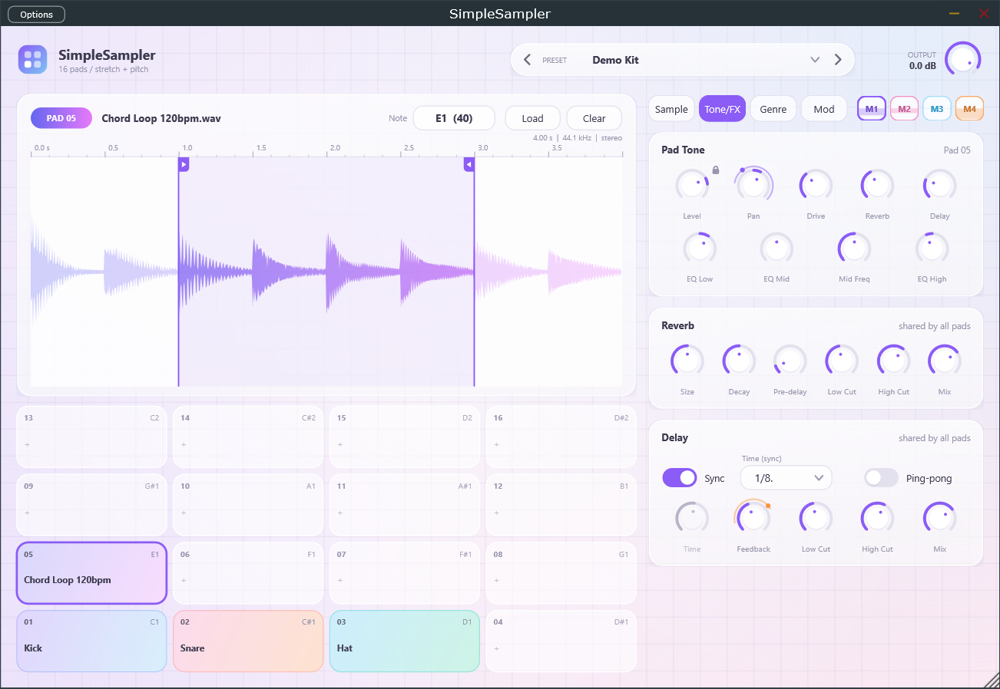
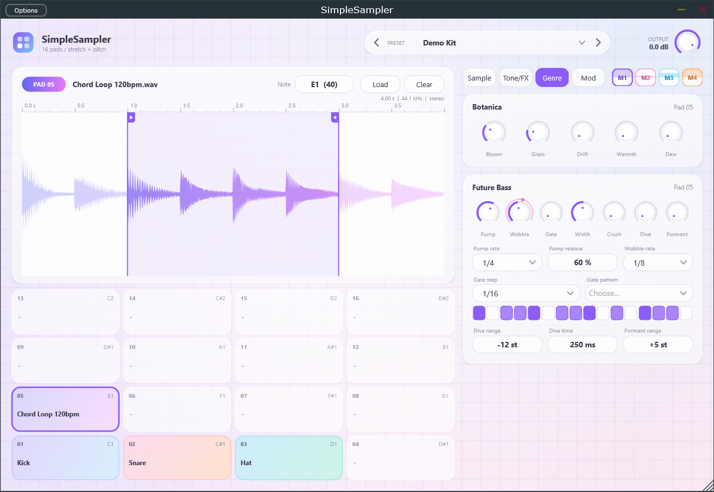
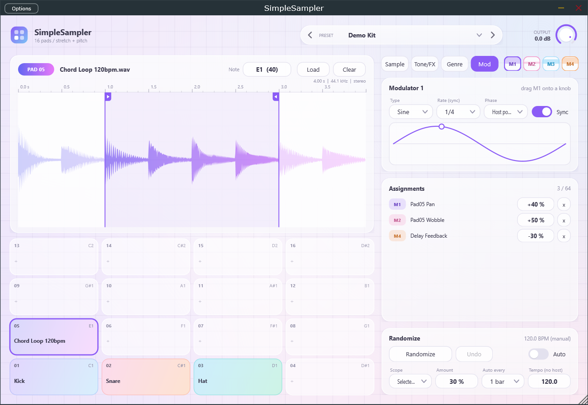

# SimpleSampler

Windows 用の 16 パッド・サンプラー(VST3 / Standalone)。JUCE + CMake 製。
パッドごとに **BPM だけ**(タイムストレッチ)と **ピッチだけ**(ピッチシフト)を独立して変えられます。
バージョン 2 でミキサー、エフェクト、ジャンル向けノブ、モジュレーション、ランダマイザーが加わりました。
Studio One での個人利用を想定しています。



## インストール / 更新(これだけ)

1. **Studio One を終了する**(起動中でも入れ替えはできますが、新しい版が読み込まれるのは Studio One の再起動後です)
2. `install.bat` をダブルクリック(未ビルドなら自動でビルドしてからコピーします)
3. 「管理者として実行しますか」に「はい」
4. 黒い画面に `OK - the new version is installed and verified.` と出たことを確認(コピー後にファイルを照合しています)
5. Studio One を起動 → ブラウザの「インストゥルメント」に **SimpleSampler**(ベンダー: HomeMade)。画面左上の名前の下に `v2.0.0` と出ていれば新しい版です

コピー先: `C:\Program Files\Common Files\VST3\SimpleSampler.vst3`

バージョン 1 で保存したプリセットやソングはそのまま開けます(新しい項目は初期値=何も掛からない状態になります)。

## 画面の見かた

- 左上: 選択中パッドの波形。左下: 4x4 パッド。上部: プリセットと出力ボリューム
- 右: タブで切り替えるパネル
  - **Sample** … BPM / Pitch / Loop / Envelope(バージョン 1 と同じ)
  - **Tone/FX** … 選択中パッドの Level / Pan / EQ / Drive / センド、全パッド共通の Reverb / Delay
  - **Genre** … Botanica と Future Bass のノブ(選択中パッドに掛かる)
  - **Mod** … モジュレーター、割り当て一覧、ランダマイザー
- タブの右の **M1〜M4** はモジュレーターのチップ。どのタブでも常に表示されます

### ノブの操作

| 操作 | 動き |
|---|---|
| ドラッグ(上 / 右で増える) | 値を変える |
| Shift + ドラッグ | 10 倍細かく |
| ダブルクリック | 初期値に戻す |
| マウスホイール | 少しずつ(Shift でさらに細かく) |
| マウスを乗せる | 名前の代わりに値を表示 |
| 右クリック | リセット / ランダマイズのロック / モジュレーションの深さ変更・削除 |
| M1〜M4 をドロップ | そのモジュレーターを割り当て(初期の深さ +50%) |

## 機能(バージョン 1 から)

| 項目 | 内容 |
|---|---|
| パッド | 4x4 = 16 個。各パッドに 1 ファイル(WAV / AIFF / FLAC / OGG、モノラル・ステレオ) |
| 割り当て | パッドや波形へドラッグ&ドロップ、空のパッドをクリック、`Load` ボタン、右クリックメニュー |
| MIDI | パッド 1〜16 = ノート 36(C1)〜51。波形の上の `Note` 欄で変更可能 |
| 発音 | ワンショット。連打すると重なって鳴る。最大 32 ボイス |
| BPM | 開始 BPM と結果 BPM。速度倍率 = 結果 ÷ 開始。ピッチは変わらない。`Diff` 欄と連動 |
| ピッチ | 開始ピッチと結果ピッチ(音名)、または半音数(±24)。BPM は変わらない |
| ループ | パッドごとに ON/OFF。波形上のハンドルで範囲指定。継ぎ目は約 8 ms のクロスフェード |
| エンベロープ | パッドごとの ADSR |
| プリセット | 上部のプリセット名をクリック → 保存 / 一覧 / 前後切替 |

## 追加機能(バージョン 2)

### A. パッドごとのミキサー / トーン(Tone/FX タブ上段)

| ノブ | 範囲 | 意味 |
|---|---|---|
| Level | -inf〜+6 dB | パッドの音量。いちばん左で無音 |
| Pan | 100 L〜100 R | 定位。コンスタントパワー方式で、中央は元の音量のまま |
| Drive | 0〜100% | tanh のサチュレーション。掛けても音量が大きく変わらないよう自動補正。簡易 2 倍オーバーサンプリング |
| Reverb / Delay | 0〜100% | 共通の Reverb / Delay へ送る量(フェーダー後) |
| EQ Low | ±12 dB | ローシェルフ(200 Hz) |
| EQ Mid / Mid Freq | ±12 dB / 200 Hz〜8 kHz | ピーク。周波数を動かせる |
| EQ High | ±12 dB | ハイシェルフ(5 kHz) |

### B. 共通エフェクト(全パッドのセンド先)

**Reverb**(8 本のディレイを使う FDN 方式を自作。金属的な響きを避けるため JUCE 標準は使っていません)

| ノブ | 意味 |
|---|---|
| Size | 部屋の大きさ |
| Decay | 残響時間 0.2〜12 秒 |
| Pre-delay | 残響が始まるまでの間 0〜200 ms |
| Low Cut / High Cut | 戻りの低域 / 高域をカット(High Cut を下げると残響の中の減衰も暗くなる) |
| Mix | 戻りの音量 |

**Delay**

| 項目 | 意味 |
|---|---|
| Sync | ON でホストのテンポに同期。`Time (sync)` で 4 bars〜1/32、付点、3 連符を選ぶ |
| Time | Sync OFF のときの時間(1〜2000 ms) |
| Feedback | 繰り返しの量(最大 95%) |
| Low Cut / High Cut | 繰り返しのたびに掛かるフィルター |
| Ping-pong | ON で左 → 右 → 左…と交互に返る |
| Mix | 戻りの音量 |

**リミッター**: 出力の最終段に常に入っています。-0.3 dBFS 付近で抑え、±1.0 を絶対に超えません。
万一計算が破綻して NaN などが出た場合は無音にして全エフェクトをリセットします。

### C. ジャンル向けノブ(Genre タブ)

すべて 0〜100%。**0 では完全にバイパス**(処理を通さず、CPU も使いません)。選択中のパッドに掛かります。



**Botanica**(有機的・アンビエント)

| ノブ | 意味 |
|---|---|
| Bloom | 1 オクターブ上の成分を足しながらゆっくり広がる長い残響(シマー)。専用のセンドとして働く |
| Grain | 直前の音を短い粒にして重ねる。上げるほど粒が短く、ばらつきが大きくなる |
| Drift | ゆっくりしたランダムなピッチ揺れ(最大約 ±45 セント)とパン揺れ |
| Warmth | テープ風の飽和、高域のロールオフ、ごく弱いワウフラッター |
| Dew | 高域のきらめき(高域から倍音を作るエキサイター + 高域だけのコーラス) |

**Future Bass**

| ノブ | 意味 | 下の設定欄(全パッド共通) |
|---|---|---|
| Pump | テンポに合わせて音量が凹んで戻る(サイドチェイン風) | Pump rate(周期)、Pump release(戻りの速さ) |
| Wobble | テンポ同期で開閉するレゾナンス付きローパス。ノブが深さ | Wobble rate |
| Gate | 16 ステップのトランスゲート。ノブが OFF ステップの消える深さ | Gate step(1 ステップの長さ)、Gate pattern(プリセット)、16 個のステップボタン |
| Width | ステレオを広げる(短いディレイを左右に交差させたコーラス + サイド成分の強調) | — |
| Crush | ビット数とサンプルレートを落とす | — |
| Dive | 発音の瞬間だけピッチがずれて戻る | Dive range(ずれる量。マイナスで下から)、Dive time(戻る時間) |
| Formant | 声色(フォルマント)を動かす。ピッチと長さは変わらない | Formant range(動かす量) |

### D. モジュレーション(Mod タブ)



- モジュレーターは 4 基(M1〜M4)。チップをクリックすると Mod タブでその設定が開きます
- **Type**: Sine / Triangle / Saw / Square / Random S&H / Random Smooth / Step(16 ステップをドラッグで描く)
- **Sync** ON: Rate をテンポに同期(4 bars〜1/32、付点、3 連符)。OFF: Hz で指定(0.02〜20 Hz)
  - LFO では Rate = 1 周期、Random と Step では Rate = 1 ステップの長さ
- **Phase**: `Host`(ソングの再生位置に位相を合わせる)/ `Retrigger`(発音のたびに先頭から)/ `Free`(流しっぱなし)
- **割り当て**: チップをノブにドラッグ&ドロップ。ノブの外側の薄い円弧が動く範囲、点が現在値です
- **Assignments** の表で深さ(-100〜+100%)の変更と削除ができます。ノブの右クリックからも変更できます
- 割り当てられるのは、パッドの Level / Pan / EQ / Drive / センド / ジャンルノブ 12 個と、Reverb・Delay の各ノブ、Pump release です
- BPM 変換とピッチ変換は対象外です(安定性のため従来どおり固定値)
- パッドのノブに割り当てた場合、そのパッドだけに効きます
- ホストからテンポが取れないとき(Standalone など)は `Tempo (no host)` の値(初期値 120)を使います

### E. ランダマイザー(Mod タブ下段)

- **Randomize**: ロックされていないノブを、現在値から ±Amount の範囲で動かします
- **Scope**: `Pad`(選択中パッドのトーン/ジャンル)/ `FX`(共通エフェクト)/ `Pad + FX`
- **ロック**: ノブを右クリック →「Lock」。鍵のマークが付いたノブは動きません。Level は最初からロックされています
- **Undo**: 直前の Randomize を取り消し(16 回分まで)
- **Auto**: `Auto every` で選んだ間隔(1 拍〜8 小節)ごとに、テンポに合わせて自動でランダム化。
  変化は約 60 ms かけて滑らかに移ります。自動のときはノブ自体は動かさず一時的なずれとして加えるので、
  Auto を切ると元の設定の音に戻ります(ノブの外側の点が動いて見えます)

### F. オートメーション

- すべてのパラメータ(655 個)がホストから見えます。名前は `Pad01 Level`、`Reverb Mix`、`Mod1 Rate (Sync)` など
- グループ: `Pad 01`〜`Pad 16` / `FX` / `Genre` / `Mod`
- パラメータの変化は内部で数 ms〜20 ms かけて滑らかに反映します
- オートメーション対象外: 各パッドの MIDI ノート番号、開始ピッチ、手動テンポ

## プリセットと互換性

- 保存先: `ドキュメント\SimpleSampler\Presets\<名前>.sspreset`(中身は XML)
- プリセットとプラグインの状態には **バージョン番号** が入っています(現在 2)
  - バージョン 1 のファイルも読めます。入っていない項目(ミキサー、エフェクト、ジャンル、モジュレーター、割り当て、ロック)はすべて初期値になります
  - 読み込んで保存し直すとバージョン 2 になります
  - 知らない項目が入ったファイル(将来の版など)は、分かる部分だけ読み込みます
- モジュレーターの設定、割り当て、ロックもプリセットとソングに保存されます
- サンプルは絶対パスとファイル名の両方を記録します。絶対パスに無いときは、プリセットと同じフォルダ、その中の `Samples`、`ドキュメント\SimpleSampler\Samples` の順に同じファイル名を探します

## Studio One での読み込み手順

1. `install.bat` を実行してから Studio One を起動(起動時に VST3 を自動スキャンします)
2. ブラウザ(F5)→「インストゥルメント」→ **SimpleSampler** をトラックへドラッグ
3. 一覧に出ない、または古い版のままに見える場合:
   - `Studio One > オプション > ロケーション > VST プラグイン` を開く
   - 「起動時にスキャン」にチェックが入っていることを確認
   - **「ブロックリストをリセット」** を押して Studio One を再起動
4. Launchpad を使う場合: `オプション > 外部デバイス > 追加 > 新規キーボード` で登録し、Launchpad 側はノートを送るモード(Drum / Note / Custom)にします

## ビルド手順

必要なもの: Visual Studio 2022(「C++ によるデスクトップ開発」)、Git、CMake(Visual Studio 同梱のものを自動で見つけます)。
JUCE 8.0.9 と Signalsmith Stretch 1.4.0 は CMake が自動でダウンロードします。

```powershell
.\build.ps1          # 構成 → Release ビルド → テスト実行
.\build.ps1 -Clean   # ビルドフォルダを消してやり直す
.\install.ps1        # C:\Program Files\Common Files\VST3 へコピー(自動で管理者権限を要求)
```

PowerShell のスクリプト実行が禁止されている場合:

```powershell
powershell -ExecutionPolicy Bypass -File .\build.ps1
```

- **ビルドフォルダ**: プロジェクトのパスが長い(60 文字超)ときは `%LOCALAPPDATA%\SimpleSamplerBuild` にビルドします(MSVC の 260 文字制限のため)。環境変数 `SIMPLESAMPLER_BUILD_DIR` で指定もできます
- **差分ビルドについて**: この環境では、ヘッダだけを変更したときに MSBuild が再コンパイルを見落とし、古いオブジェクトが混ざることがありました。`build.ps1` はこのプロジェクト自身のソースを毎回コンパイルし直します(JUCE 本体は再利用するので 1〜2 分で済みます)。`cmake --build` を直接使う場合は注意してください

## テスト

```powershell
.\build.ps1                         # ビルド後に自動テストを実行(439 項目)
.\scripts\run-pluginval.ps1         # pluginval で VST3 を検証
.\scripts\run-pluginval.ps1 -Strictness 8
```

自動テストは実際に音をレンダリングして確かめています。バージョン 2 で追加した分:

- テンポ同期の計算(音価 → 拍・ms、モジュレーターの波形、ランダムの再現性、Pump / Gate の曲線)
- パラメータ(個数、ID と名前の重複なし、初期値が範囲内、グループ名、モジュレーション対象)
- 初期状態では元のサンプルと一致すること(信号経路が透明であること)
- Level / Pan / EQ / Drive の効き、Reverb の残響、Delay のエコー位置(手動テンポ・ホストテンポ・フリー・ピンポン)、リミッター
- ジャンルノブ 12 個それぞれ: 音が変わる、破綻しない、0% で元の音と一致する
- Pump / Gate / Wobble のタイミング、Dive の音程とテンポ維持、Drift / Formant の長さ維持、Width、Bloom
- モジュレーション(計算、ホスト位置への同期、テンポ追従、Retrigger、Hz 指定、ステップ、共通エフェクトへの割り当て)
- ランダマイザー(範囲、スコープ、ロック、Undo、Auto の拍同期と元に戻ること)
- 状態の保存/復元、**バージョン 1 の状態とプリセットの読み込み**、未知の項目への耐性
- 負荷: 16 パッドを全エフェクト・全モジュレーター ON で同時に鳴らす

実施済みの検証(このリポジトリの最終状態に対して): 自動テスト 439 項目合格、pluginval strictness 5 と 8 で SUCCESS。
負荷テストは開発機で 1 コアの約 33%(16 ボイスすべてストレッチ + 全ジャンルノブ + センド)、無音時は約 0.1% でした。

## 仮定(仕様の曖昧な点をこう解釈しました)

バージョン 1 から:

1. **音名**: 60 = C3、36 = C1(Studio One と同じ)
2. **パッドの並び**: パッド 1(C1)が左下
3. **BPM**: 「開始 BPM」と「結果 BPM」をパラメータとして持つ。開始を変えても結果は動かない
4. **ピッチ**: 「開始ピッチ」と「半音数」をパラメータとして持つ
5. **値の固定**: BPM・ピッチ・ループ・ADSR は発音時の値を使う
6. **ループ**: 先頭から再生し、ループ終了位置でループ開始位置へ戻る。ループ周期は正確に保つ
7. **空のパッドのクリック**: ファイル選択を開く
8. **マウスで鳴らすときのベロシティ**: 0.85 固定
9. **同名で保存**: 確認なしで上書き
10. **32 ボイス上限**: 超えたら最も古いボイスを約 5 ms でフェードアウト
11. **メーカー名**: `HomeMade`

バージョン 2:

12. **ジャンルノブはパッド単位**。ただし Pump / Wobble / Gate の周期、Gate のパターン、Dive / Formant の幅は全パッド共通の設定にしました(パラメータ数を抑えるため)
13. **Gate のステップは 16 個の ON/OFF パラメータが実体**。パターンのメニューはその 16 個を書き換えるだけです
14. **Reverb は FDN を自作**。Tone は Low Cut / High Cut の 2 つのノブにしました
15. **Bloom は Reverb とは別の長い残響**(シマー)として実装し、Reverb の戻りに足しています。Reverb の Low Cut / High Cut は掛かりますが、Reverb Mix には影響されません(Mix を 0 にしても Bloom は聞こえます)
16. **Drive のオーバーサンプリングは簡易版**: サンプル間の中点も歪ませて平均する方式です(遅延ゼロ。折り返しを軽く抑える程度)
17. **Grain は簡易グラニュラー**: 直前 0.2 秒ほどの音から最大 4 粒を重ねます。ピッチを変える粒や逆再生はありません
18. **Formant は簡易版ではなく**、Signalsmith Stretch のフォルマント処理を使っています。ただしストレッチ処理を通るボイスにしか効かないため、**発音時に Formant が 0 のボイスには後から上げても効きません**(次の発音から効きます)
19. **Dive / Drift / Formant を使うボイスは、BPM を変えていなくてもストレッチ処理を通します**。ピッチが動いてもテンポを正確に保つためです(その分 CPU を使います)。発音時に 3 つとも 0 だったボイスに後から Drift を掛けた場合はテープ式(わずかに速度も揺れる)になります
20. **モジュレーターは全体で 4 基**(ボイスごとではない)。`Retrigger` はどのパッドの発音でも先頭に戻ります
21. **モジュレーターの出力は -1〜+1**。深さ 100% でノブの全範囲ぶん動きます。Step の各ステップも -1〜+1 です
22. **拍子は 4/4 固定**で小節を数えます(1 bar = 4 拍)
23. **テンポの時計**: ホストが再生中は再生位置(PPQ)に合わせ、停止中やホストが無いときは内部で流し続けます。そのため停止中でも Pump や LFO は動きます
24. **モジュレーションとパラメータの更新は最大 64 サンプルごと**(48 kHz で約 1.3 ms)。MIDI の発音位置はサンプル単位で正確です
25. **自動ランダマイズはノブを動かさない**方式(上記 E)。手動の Randomize は実際の値を変えます
26. **Level は最初からランダマイズのロック付き**(音量が突然変わるのを避けるため)。右クリックで解除できます
27. **値が 0 のノブは Randomize で上にしか動きません**(範囲の端で止まるため)
28. **ホストに出すパラメータ名を `Pad01 ...` の形にそろえました**(バージョン 1 では `Pad 1 ...`)。ID は変えていないので既存のオートメーションはそのまま使えます
29. **ウィンドウの初期サイズを 1140x720 に拡大**(最小 1040x690)。バージョン 1 で保存した小さいサイズは最小サイズに広げて開きます
30. **Delay Time は Sync ON のときモジュレーション対象外**(音価が優先されます)

## 確認チェックリスト(Studio One で実際に確かめてほしい項目)

こちらの環境では Studio One の中での動作、マウス操作、耳での音質確認はできていません。

基本(バージョン 1 から):

- [ ] インストゥルメント一覧に出る / 画面が開いてリサイズできる
- [ ] WAV をドロップして、クリックと MIDI(C1〜D#2)で鳴る / 連打で重なる
- [ ] BPM を変えると速さだけ、ピッチを変えると音程だけ変わる
- [ ] ループ、ADSR、プリセット保存・読み込みが動く
- [ ] **バージョン 1 で作ったソングとプリセットがそのまま開き、同じ音で鳴る**

バージョン 2:

- [ ] タブ(Sample / Tone/FX / Genre / Mod)が切り替わる
- [ ] ノブ: ドラッグ、Shift で微調整、ダブルクリックでリセット、マウスを乗せると値が出る
- [ ] Level / Pan / EQ / Drive が選択中のパッドだけに効く
- [ ] Reverb / Delay がセンド量に応じて掛かる。Delay がソングのテンポに合う
- [ ] **ソングのテンポを変えると、Delay・Pump・Wobble・Gate・LFO が追従する**
- [ ] **再生位置を変えても、Pump や LFO が小節の頭に合う**(Phase = Host)
- [ ] ジャンルノブ 12 個がそれぞれ効き、0 に戻すと元の音に戻る(音質が好みかどうかも)
- [ ] M1〜M4 をノブにドラッグ&ドロップできる。ノブの外側に範囲の円弧が出て、点が動く
- [ ] Assignments の表で深さの変更と削除ができる
- [ ] Step モジュレーターのステップをドラッグで描ける
- [ ] Randomize / Undo / ロックが動く。Auto がテンポに合って切り替わり、切ると元の音に戻る
- [ ] **オートメーションを記録・再生できる**(例: `Pad01 Level`、`Reverb Mix`)。パラメータがグループに分かれて見える
- [ ] 大きな音を出してもクリップせず、リミッターで止まる
- [ ] 16 パッドを鳴らし全エフェクトを使っても音切れしない(CPU 負荷)
- [ ] ソングを保存して開き直すと、モジュレーションの割り当てやロックも復元される

## 既知の制限

- **音質(ストレッチ)**: 位相ボコーダ方式のため、大きな倍率や ±12 半音を超える移調ではアタックのにじみが出ます
- **CPU**: ストレッチを使うボイス(BPM / ピッチ変換、Dive、Drift、Formant のいずれかを使うパッド)がいちばん重い処理です。多数を同時に叩くと発音の瞬間に負荷が上がります
- **Dive / Drift のピッチ移動はリサンプリング方式**で、大きく上げたとき(+12 半音以上)は高域に折り返しノイズが出ることがあります
- **Formant / Dive は発音時の値で決まる部分があります**(仮定 18、19)
- **リミッターは先読み無し**: 耳と機材を守るためのもので、強く当てると歪みます。音量は Level と出力ボリュームで調整してください
- **Reverb の Size を動かすと残響のピッチが揺れます**(ディレイの長さが変わるため)
- **割り当ては最大 64 個**
- **モジュレーションの深さは表か右クリックで変更**します(ノブ上で直接ドラッグして深さを変える操作はありません)
- **拍子は 4/4 固定**。変拍子では小節単位の同期がずれます
- **サンプルの長さ**: 1 ファイル最大 10 分。全体をメモリに読み込みます
- **サンプルレート変換**: 高いレートから低いレートへの変換では専用のアンチエイリアスフィルタを掛けていません
- **MP3 は非対応**。プリセットは音声ファイル自体をコピーしません。MIDI ラーン無し
- パラメータが 655 個あるため、ホストのオートメーション一覧は長くなります(グループで畳めます)
- ダークモード無し。macOS / Linux は未確認

## ファイル構成

```
CMakeLists.txt            ビルド定義(JUCE / Signalsmith Stretch を自動取得)
build.ps1                 ビルド + テスト
install.ps1 / install.bat VST3 のインストール
scripts/                  CMake などの検出、pluginval の実行
Source/
  PluginProcessor.*       プラグイン本体、パラメータ、MIDI、信号経路、状態の保存/復元
  Voice.*                 1 ボイス(ストレッチ、ループ、ADSR、Dive / Drift 用の可変速読み出し、Formant)
  PadSlot.* SampleLoader.* PresetManager.* ParamMath.h
  FX/
    DspUtil.h             フィルター、ディレイライン、スムージングなどの部品
    Eq3.h  Drive.h        3 バンド EQ、サチュレーション
    FdnReverb.h           FDN リバーブ
    StereoDelay.h         ステレオ / ピンポンディレイ
    Limiter.h             出力リミッターと NaN ガード
    Botanica.h            Grain / Drift / Warmth / Dew / Bloom
    FutureBass.h          Wobble / Width / Crush(Pump と Gate は TempoSync.h、Dive と Formant は Voice)
    PadChannel.h          パッド 1 つ分の処理チェーン
    GlobalFx.h            センドエフェクトとマスター
  Modulation/
    TempoSync.h           音価・波形・Pump / Gate の計算(テスト対象)
    Modulator.h           テンポの時計とモジュレーター
    ModMatrix.*           割り当て表とロック
    Randomizer.h          ランダマイズ、Undo、自動ランダマイズ
  PluginEditor.*  PastelLookAndFeel.*  WaveformView.*  PadGrid.*
  ControlCards.*  EnvelopeEditor.*  NumberField.*  PresetBar.*
  UI/
    Knob.*                ノブ(操作、モジュレーション表示、ドロップ受け)
    PanelTabs.*           タブと M1〜M4 チップ
    FxPanels.*            Tone/FX タブと Genre タブ
    ModPanel.*            Mod タブ(モジュレーター、割り当て一覧、ランダマイザー)
    Widgets.h             キャプション付きコンボなど
Tests/
  Tests.cpp               バージョン 1 のテスト
  TestsV2.cpp             バージョン 2 のテスト
  TestHelpers.h           共通の補助関数
```

### 信号の流れ

```
ボイス(パッドごとのバスへ)
  → Grain → Crush → Drive → Warmth → EQ → Wobble → Dew → Width → Gate / Pump → Level / Pan
      ├→ マスター
      ├→ Reverb センド → Pre-delay → Reverb ─┐
      ├→ Bloom センド → シマー ──────────────┼→ Low Cut / High Cut → マスター
      └→ Delay センド → Delay ───────────────→ マスター
マスター → 出力ボリューム → リミッター
```

### リアルタイム処理の方針

- オーディオスレッドではメモリ確保・ファイル I/O・待ちの発生するロックをしません
- 割り当て表は固定長のアトミックな配列で、画面から編集してもオーディオ側は止まりません
- 値が 0 のエフェクト、鳴っていないパッド、入力も残響も無いセンドエフェクトは処理を丸ごと飛ばします
- デノーマル対策(`ScopedNoDenormals`)と、最終段での NaN / 異常値の検出を入れています

## ライセンスについて

- **JUCE** は AGPLv3 と商用ライセンスのデュアルライセンスです。このプロジェクトは個人利用が前提です。
  ビルドしたプラグインを配布・販売する場合は、AGPLv3 に従ってソースを公開するか、JUCE の商用ライセンスが必要です
- **Signalsmith Stretch** は MIT ライセンス
- VST は Steinberg Media Technologies GmbH の商標です
