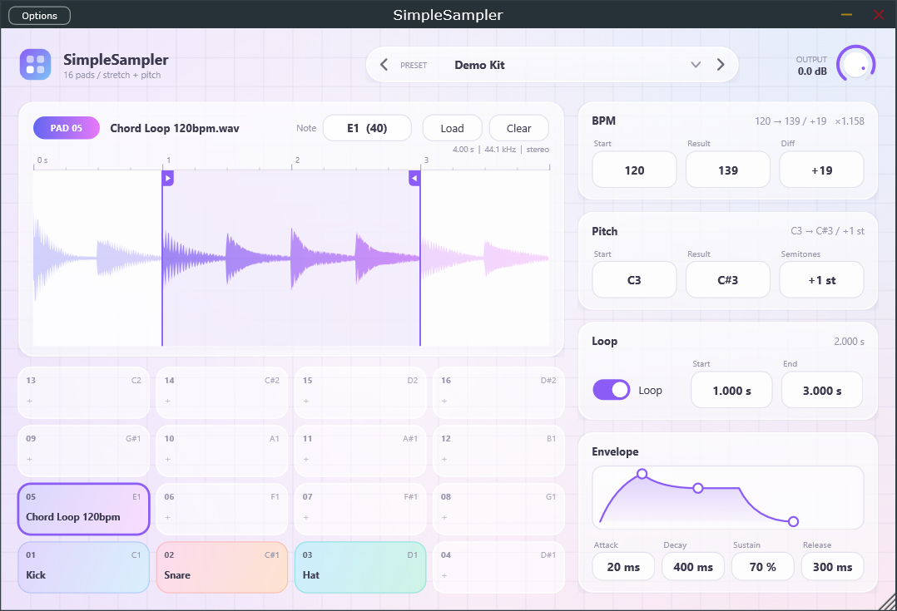

# SimpleSampler

Windows 用の 16 パッド・サンプラー(VST3 / Standalone)。JUCE + CMake 製。
パッドごとに **BPM だけ**(タイムストレッチ)と **ピッチだけ**(ピッチシフト)を独立して変えられます。
Studio One での個人利用を想定しています。



## インストール(これだけ)

1. `install.bat` をダブルクリック(未ビルドなら自動でビルドしてからコピーします)
2. 「管理者として実行しますか」に「はい」
3. Studio One を起動 → ブラウザの「インストゥルメント」に **SimpleSampler**(ベンダー: HomeMade)が出ます

コピー先: `C:\Program Files\Common Files\VST3\SimpleSampler.vst3`

## 機能

| 項目 | 内容 |
|---|---|
| パッド | 4x4 = 16 個。各パッドに 1 ファイル(WAV / AIFF / FLAC / OGG、モノラル・ステレオ) |
| 割り当て | パッドや波形へドラッグ&ドロップ、空のパッドをクリック、`Load` ボタン、右クリックメニュー |
| MIDI | パッド 1〜16 = ノート 36(C1)〜51。波形の上の `Note` 欄で変更可能 |
| 発音 | ワンショット(ノートオフでは止まらない)。連打すると重なって鳴る。最大 32 ボイス、超えたら古い順にフェードアウト |
| BPM | 開始 BPM と結果 BPM を指定。速度倍率 = 結果 ÷ 開始。ピッチは変わらない。`Diff` 欄(例 +16)と結果 BPM は連動 |
| ピッチ | 開始ピッチと結果ピッチ(音名)、または半音数(±24)。BPM は変わらない。3 つの欄は連動 |
| ループ | パッドごとに ON/OFF。波形上のハンドルをドラッグして範囲指定。継ぎ目は約 8 ms のクロスフェード |
| エンベロープ | パッドごとの ADSR。曲線の 3 つの点をドラッグ、または数値欄で指定 |
| プリセット | 上部のプリセット名をクリック → 保存 / 別名で保存 / 一覧から読み込み / ファイルから読み込み。左右の矢印で前後に切替 |
| 出力 | 右上のノブが出力ボリューム |

BPM とピッチの値は **発音した瞬間の値で固定** されます(鳴っている最中には変化しません)。
BPM もピッチも変えていないパッドは、ストレッチ処理を通さず元の音をそのまま再生します。

### 操作のコツ

- 数値欄: 上下ドラッグ / マウスホイールで増減(Shift で細かく)。クリックすると直接入力。Alt + ダブルクリックで初期値
- ピッチ欄は `C3`、`C#3`、`Db3`、`60` のどれでも入力可(60 = C3、36 = C1 の表記)
- ループ欄は秒で入力(`%` を付けると割合)
- ループ ON のパッドは、鍵盤(またはマウス)を離すとリリースして止まります
- パッドの右クリックで「差し替え / クリア」。複数ファイルをまとめてドロップすると、そのパッドから順に割り当て

### プリセットの保存先

`ドキュメント\SimpleSampler\Presets\<名前>.sspreset`(中身は XML)

サンプルは **絶対パスとファイル名の両方** を記録します。絶対パスに無いときは、同じファイル名を次の順に探します。

1. プリセットファイルと同じフォルダ、およびその中の `Samples`
2. `ドキュメント\SimpleSampler\Samples`

見つからないパッドは赤字で `Missing` と表示され、クリックで選び直せます(パスの情報は消えません)。
Studio One のソングを保存すれば、同じ内容がソングにも保存・復元されます。

## Studio One での読み込み手順

1. `install.bat` を実行してから Studio One を起動(起動時に VST3 を自動スキャンします)
2. ブラウザ(F5)→「インストゥルメント」→ ベンダー別なら `HomeMade` → **SimpleSampler** をトラックへドラッグ
3. 一覧に出ない場合:
   - `Studio One > オプション > ロケーション > VST プラグイン` を開く
   - 「起動時にスキャン」にチェックが入っていることを確認
   - **「ブロックリストをリセット」** を押して Studio One を再起動
4. Launchpad を使う場合: `オプション > 外部デバイス > 追加 > 新規キーボード` で Launchpad の MIDI 入力を登録し、
   Launchpad 側はノートを送るモード(Drum / Note / Custom)にします。Drum レイアウトの左下 4x4 が 36〜51 です

## ビルド手順

必要なもの: Visual Studio 2022(「C++ によるデスクトップ開発」)、Git、CMake。
CMake は Visual Studio に同梱のものを自動で見つけるので、別途インストールしなくても動きます。
JUCE 8.0.9 と Signalsmith Stretch 1.4.0 は CMake の FetchContent が自動でダウンロードします。

```powershell
.\build.ps1          # 構成 → Release ビルド → テスト実行
.\build.ps1 -Clean   # ビルドフォルダを消してやり直す
.\install.ps1        # C:\Program Files\Common Files\VST3 へコピー(自動で管理者権限を要求)
```

PowerShell のスクリプト実行が禁止されている場合:

```powershell
powershell -ExecutionPolicy Bypass -File .\build.ps1
```

手動でビルドする場合:

```powershell
cmake -S . -B build -G "Visual Studio 17 2022" -A x64
cmake --build build --config Release --parallel
```

**ビルドフォルダの場所について**: MSVC は 260 文字を超えるパスを扱えず、JUCE のフォルダは深いので、
プロジェクトのパスが長い(60 文字超)ときは `%LOCALAPPDATA%\SimpleSamplerBuild` にビルドします。
短いパスに置いた場合は `build\` に作られます。環境変数 `SIMPLESAMPLER_BUILD_DIR` で指定もできます。

成果物(ビルドフォルダ内):

- `SimpleSampler_artefacts\Release\VST3\SimpleSampler.vst3`
- `SimpleSampler_artefacts\Release\Standalone\SimpleSampler.exe`(単体で動作確認できる版)

## テスト

```powershell
.\build.ps1                         # ビルド後に自動テストを実行(127 項目)
.\scripts\run-pluginval.ps1         # pluginval で VST3 を検証(初回は公式リリースを自動ダウンロード)
.\scripts\run-pluginval.ps1 -Strictness 8
```

自動テスト(`Tests/Tests.cpp`)は実際に音をレンダリングして確かめています。

- ストレッチ倍率の計算、BPM の「差分 ⇔ 結果」連動、ピッチの「音名 ⇔ 半音」連動
- BPM 変更で長さだけ変わりピッチは変わらない / ピッチ変更でピッチだけ変わり長さは変わらない / 両方同時
- 発音の遅れが無いこと、ワンショットがノートオフで止まらないこと
- ループの継続・ノートオフでの停止・継ぎ目にクリックが無いこと(3 種類のループ位置)
- ADSR、32 ボイス上限、連打での重なり、ノート番号変更
- 44.1 kHz モノラルのファイルを 48 kHz のホストで鳴らす変換
- 状態の保存/復元、移動したサンプルの再発見、プリセットの保存・読み込み・前後切替・削除

実施済みの検証: 自動テスト 127 項目合格、pluginval strictness 5 および 8 で SUCCESS。

## 仮定(仕様の曖昧な点をこう解釈しました)

1. **音名**: 仕様の「C1 = 36」に合わせ、60 = C3 の表記(Studio One と同じ)
2. **パッドの並び**: パッド 1(C1)が左下、右へ・上へ進む(ドラムパッド/Launchpad の Drum レイアウトと同じ)
3. **BPM の保持方法**: 「開始 BPM」と「結果 BPM」をパラメータとして持ち、差分は表示用。開始 BPM を変えても結果 BPM は動かない(差分の表示が変わる)
4. **ピッチの保持方法**: 「開始ピッチ」と「半音数」をパラメータとして持ち、結果ピッチは表示用。開始ピッチを変えると結果ピッチも同じだけ動く(半音数を保つ)
5. **値の固定**: BPM・ピッチ・ループ・ADSR は発音時の値を使い、鳴っている音には反映しない。変更は次の発音から有効
6. **ループ再生**: サンプルの先頭から再生を始め、ループ終了位置に達したらループ開始位置へ戻る
7. **ループの長さを正確に保つ**: クロスフェードはループ周期を変えない方式。ループ開始より前に音があればそれを、無ければループ終了より後ろの音を重ねる。ファイル全体をループする場合だけは重ねる素材が無いので、継ぎ目で約 4 ms ずつフェードアウト/イン
8. **空のパッドのクリック**: ファイル選択を開く。サンプルのあるパッドのクリックは「選択 + 発音」
9. **マウスで鳴らすときのベロシティ**: 0.85 固定。MIDI はベロシティに比例した音量
10. **ノート番号と開始ピッチ**: オートメーション対象外(それ以外の全パラメータは DAW からオートメーション可能)
11. **サンプルレート変換**: 読み込み時(別スレッド)にホストのサンプルレートへ変換して保持。ホストのレートが変わったら自動で読み込み直す
12. **新しいサンプルを割り当てたとき**: そのパッドのループ範囲を全体(0〜100%)に戻す。BPM などはそのまま
13. **同名で「別名で保存」**: 確認なしで上書き
14. **32 ボイス上限**: 超えたら最も古いボイスを約 5 ms でフェードアウト
15. **エンベロープの最小値**: Attack 1 ms、Decay 1 ms、Release 5 ms
16. **BPM の範囲**: 20〜400、**ピッチ**: ±24 半音
17. **メーカー名**: `HomeMade`(Studio One のベンダー欄に表示)

## 確認チェックリスト(Studio One で実際に確かめてほしい項目)

こちらの環境では Studio One の中での動作と、耳での音質確認はできていません。

- [ ] Studio One のインストゥルメント一覧に SimpleSampler が出る
- [ ] トラックに挿すと画面が開き、リサイズできる
- [ ] WAV をパッドへドラッグ&ドロップして、クリックで鳴る
- [ ] MIDI キーボード / ピアノロールの C1〜D#2 で各パッドが鳴る
- [ ] Launchpad を接続して叩くと鳴り、叩いたパッドが光る
- [ ] 同じパッドを連打すると音が切れずに重なる
- [ ] BPM を 123 → 139 にすると速くなり、音程は変わらない(音質も許容範囲か)
- [ ] ピッチを +1 にすると半音上がり、長さは変わらない
- [ ] BPM とピッチを同時に設定できる
- [ ] ループ ON で鍵盤を押している間ループし、離すと止まる。継ぎ目でプチッと言わない
- [ ] 波形上のループハンドルをドラッグできる。再生中に縦線が動く
- [ ] ADSR の曲線をドラッグすると音の立ち上がり・余韻が変わる
- [ ] プリセットを保存 → 別のプリセットに切替 → 戻すと元通り
- [ ] ソングを保存して開き直すと、サンプルと全設定が復元される
- [ ] パラメータをオートメーションできる(例: Pad 1 Result BPM)
- [ ] サンプルレートを 44.1 kHz ⇔ 48 kHz に変えても音程・速度が変わらない
- [ ] 多数のパッドを同時に鳴らしても音切れしない(CPU 負荷)

## 既知の制限

- **音質**: Signalsmith Stretch は位相ボコーダ方式。大きな倍率(半分以下/2 倍以上)や ±12 半音を超える移調では、アタックのにじみや質感の変化が出ます
- **CPU**: ストレッチ/ピッチを使うボイスは 1 つずつ専用の処理を持つので、多数を同時に鳴らすと重くなります。発音の瞬間に遅れを打ち消すための先読み計算をするため、ストレッチ付きのパッドを大量に同時に叩くと一瞬負荷が上がります(BPM・ピッチを変えていないパッドは軽い)
- **サンプルの長さ**: 1 ファイル最大 10 分。全体をメモリに読み込みます
- **サンプルレート変換**: 高いレートから低いレートへの変換では専用のアンチエイリアスフィルタを掛けていません(96 kHz 素材を 44.1 kHz で使うと高域にわずかな折り返しの可能性)
- **MP3 は非対応**(WAV / AIFF / FLAC / OGG)
- **プリセットはサンプルの場所を記録するだけ** で、音声ファイル自体はコピーしません。別の PC へ持っていくときは、サンプルをプリセットと同じフォルダ(または `Samples`)に置いてください
- **MIDI ラーン無し**: ノート番号は手入力(またはドラッグ)で設定
- **波形の時間目盛り** は元のサンプルの時間(ストレッチ後の時間ではない)
- パラメータは 16 パッド × 12 + 1 = 193 個あり、DAW のオートメーション一覧は長くなります(パッドごとのグループに分かれています)
- ダークモード無し。macOS / Linux は未確認(コードは JUCE の標準機能のみですが、スクリプトは Windows 専用)

## ファイル構成

```
CMakeLists.txt            ビルド定義(JUCE / Signalsmith Stretch を自動取得)
build.ps1                 ビルド + テスト
install.ps1 / install.bat VST3 のインストール
scripts/common.ps1        CMake・Visual Studio・ビルドフォルダの検出
scripts/run-pluginval.ps1 pluginval による検証
Source/
  PluginProcessor.*       プラグイン本体、パラメータ、MIDI、状態の保存/復元
  Voice.*                 1 ボイス(ストレッチ/ピッチ、ループ読み出し、ADSR)
  PadSlot.*               パッド(パラメータ、サンプルの受け渡し、表示用の値)
  SampleLoader.*          別スレッドでの読み込みとサンプルレート変換
  PresetManager.*         プリセットの保存・読み込み・一覧
  ParamMath.h             倍率・連動入力・音名の計算(テスト対象)
  PluginEditor.*          画面全体のレイアウト
  PastelLookAndFeel.*     見た目(トグル、ノブ、ボタン、メニュー、カード、背景)
  WaveformView.*          波形、時間目盛り、ループハンドル、再生位置
  PadGrid.*               4x4 パッド
  ControlCards.*          BPM / Pitch / Loop / Envelope カード
  EnvelopeEditor.*        ドラッグできる ADSR 曲線
  NumberField.*           数値入力欄
  PresetBar.*             プリセット名と前後ボタン、メニュー
Tests/Tests.cpp           自動テスト
```

### リアルタイム処理の方針

- オーディオスレッドではメモリ確保・ファイル I/O・待ちの発生するロックをしません
- サンプルは読み込みスレッドで読み込み・変換し、完成したものをポインタの差し替えで渡します(オーディオ側は待たない try-lock)
- 再生中のサンプルは本体が参照を持ち続けるので、オーディオスレッドで解放されることはありません
- ストレッチ用のバッファは `prepareToPlay` で全ボイス分を確保済みです

## ライセンスについて

- **JUCE** は AGPLv3 と商用ライセンスのデュアルライセンスです。このプロジェクトは個人利用が前提です。
  ビルドしたプラグインを配布・販売する場合は、AGPLv3 に従ってソースを公開するか、JUCE の商用ライセンスが必要です
- **Signalsmith Stretch** は MIT ライセンス
- VST は Steinberg Media Technologies GmbH の商標です
